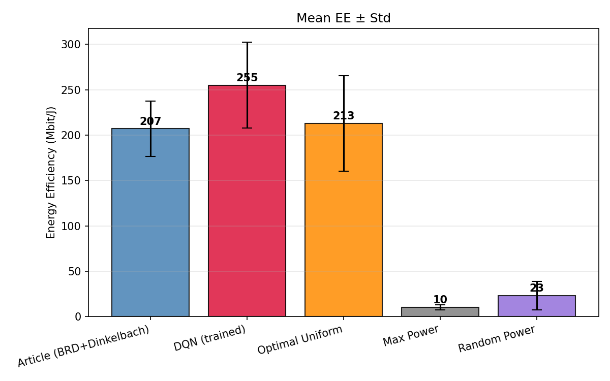
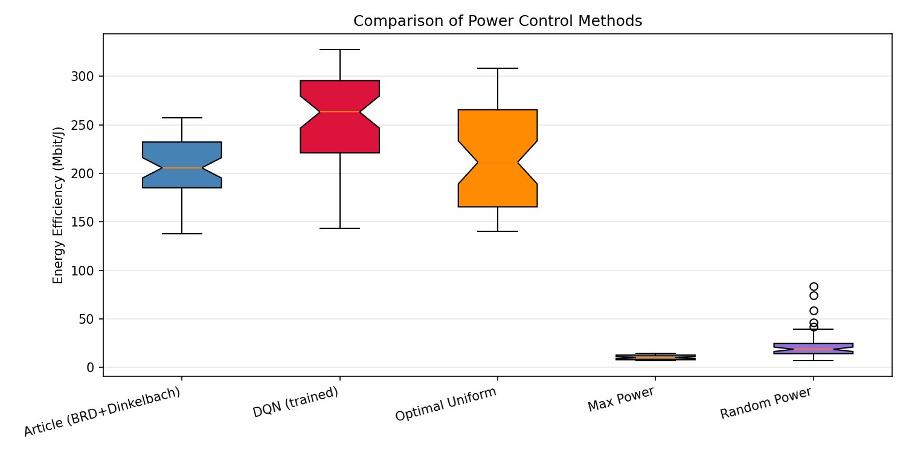
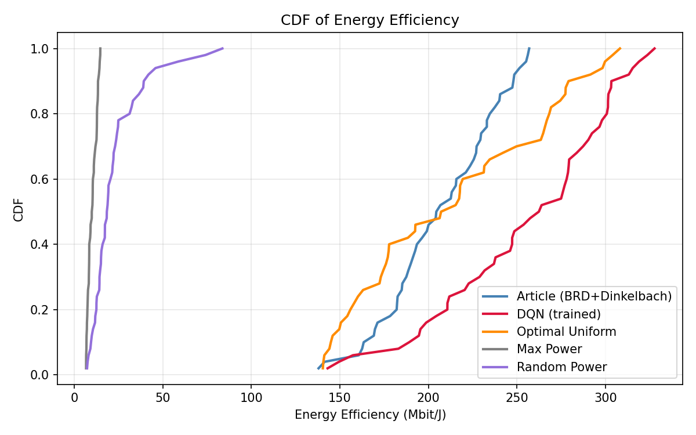
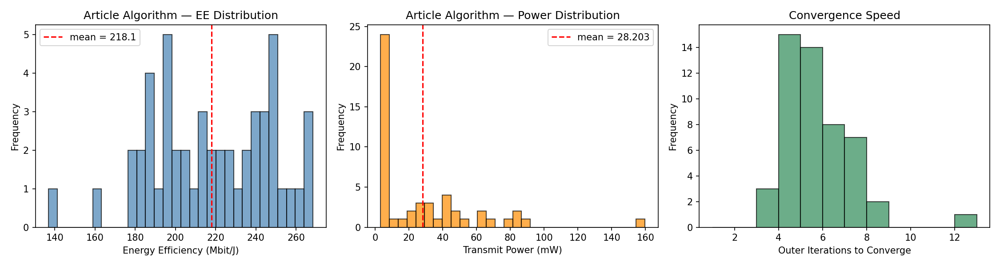
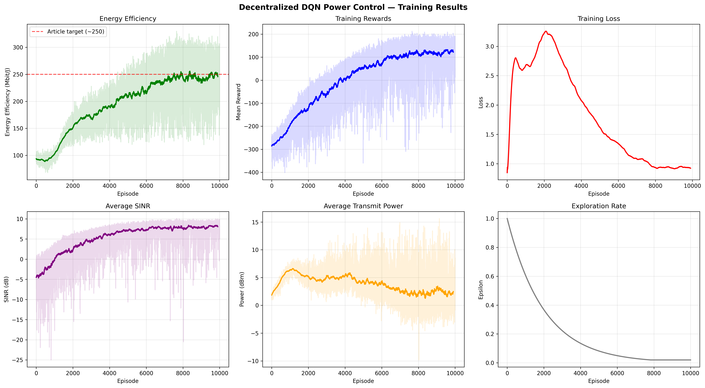

# Analyse Comparative : Contrôle de Puissance par DQN vs Algorithme de l'Article

**Projet :** Contrôle de puissance éco-énergétique dans un réseau Massive MIMO 5G  
**Référence :** A. Zappone et al., *"Energy-Efficient Power Control: A Look at 5G Wireless Technologies"*, IEEE, 2015  
**Date :** Février 2026

---

## 1. Contexte et Objectif

Ce projet implémente et compare deux approches de contrôle de puissance décentralisé pour maximiser l'**efficacité énergétique (EE)** (en Mbit/J) dans un réseau Massive MIMO :

1. **Algorithme de l'article** — Approche analytique basée sur la Best Response Dynamics (BRD) couplée à l'algorithme de Dinkelbach pour résoudre le problème fractionnel d'optimisation de l'EE.
2. **DQN (Deep Q-Network)** — Approche par apprentissage par renforcement profond où chaque utilisateur dispose d'un agent DQN indépendant apprenant à choisir son niveau de puissance.

Les deux méthodes sont comparées sur les **mêmes réalisations de canal** (échantillons appariés) pour garantir l'équité de la comparaison. Trois baselines supplémentaires servent de référence.

---

## 2. Configuration du Système

| Paramètre | Valeur |
|---|---|
| Nombre d'utilisateurs ($K$) | 5 |
| Nombre d'antennes BS ($M$) | 50 |
| Bande passante ($B$) | 1 MHz |
| Puissance max UE ($\bar{p}$) | 23 dBm (≈ 200 mW) |
| Puissance min UE | −20 dBm (≈ 0,01 mW) |
| Puissance de circuit ($p_c$) | 10 dBm (10 mW) |
| Impairments matériels ($\varepsilon^2$) | 0,008 → $\gamma_{\max} = 125$ (21 dB) |
| Débit max théorique | 6,98 bit/s/Hz |
| Contrainte QoS ($\theta_k$) | 20 % de $\log_2(1 + \gamma_{\max})$ ≈ 1,40 bit/s/Hz |
| Rayon de cellule | 400 m |
| Distance min UE–BS | 35 m |
| Nombre d'essais | 50 |

### Hyperparamètres DQN

| Paramètre | Valeur |
|---|---|
| Architecture | 3 couches cachées : [128, 256, 128] |
| Activation | ReLU |
| Taux d'apprentissage | $10^{-4}$ |
| Taille du batch | 256 |
| Facteur d'actualisation ($\gamma$) | 0,95 |
| Taille buffer replay | 100 000 |
| Mise à jour cible (soft) | $\tau = 0,005$, toutes les 500 étapes |
| Exploration $\varepsilon$-greedy | $1,0 \to 0,02$ (décroissance 0,9995/épisode) |
| Niveaux d'action | 32 (espacement logarithmique) |
| Fonction de perte | Huber ($\delta = 1,0$) |
| Épisodes totaux | 10 000 |

---

## 3. Méthodes Comparées

| Méthode | Description |
|---|---|
| **Article (BRD+Dinkelbach)** | Algorithme décentralisé itératif de l'article. Chaque utilisateur calcule sa meilleure réponse via l'algorithme de Dinkelbach, en ne nécessitant que son propre SINR mesuré. Convergence garantie vers un équilibre de Nash généralisé unique. |
| **DQN (entraîné)** | 5 agents DQN indépendants (un par utilisateur). Chaque agent observe son état local (SINR, puissance, taux, violation QoS, etc.) et choisit parmi 32 niveaux de puissance. Évaluation en mode glouton ($\varepsilon = 0$). |
| **Optimal Uniform** | Recherche exhaustive sur 100 niveaux de puissance uniforme (même puissance pour tous les utilisateurs). Trouve le meilleur niveau commun maximisant l'EE moyenne. |
| **Max Power** | Tous les utilisateurs transmettent à puissance maximale ($\bar{p} = 200$ mW). |
| **Random Power** | Puissances tirées aléatoirement entre $p_{\min}$ et $p_{\max}$. |

---

## 4. Résultats Quantitatifs

### 4.1 Tableau Récapitulatif (50 essais)

| Méthode | EE Moyenne (Mbit/J) | Écart-type (Mbit/J) | Puissance Moyenne (mW) |
|---|---:|---:|---:|
| **DQN (entraîné)** | **255,16** | 47,31 | 15,27 |
| Optimal Uniform | 213,04 | 52,76 | 0,023 |
| Article (BRD+Dinkelbach) | 207,01 | 30,67 | 28,73 |
| Max Power | 10,22 | 2,55 | 199,53 |
| Random Power | 23,06 | 15,59 | 100,57 |

### 4.2 Performance Relative par Rapport à l'Algorithme de l'Article

| Méthode | EE Moyenne (Mbit/J) | Écart vs Article |
|---|---:|---:|
| **DQN (entraîné)** | 255,16 | **+23,3 %** |
| Optimal Uniform | 213,04 | +2,9 % |
| Article (BRD+Dinkelbach) | 207,01 | — (référence) |
| Random Power | 23,06 | −88,9 % |
| Max Power | 10,22 | −95,1 % |

> **Résultat clé :** Le DQN surpasse l'algorithme de l'article de **+23,3 %** en efficacité énergétique moyenne. C'est la méthode la plus performante parmi les cinq testées.

---

## 5. Analyse des Graphiques

### 5.1 Diagramme en Barres (`comparison_bar.png`)

Ce graphique présente l'**EE moyenne ± écart-type** pour chaque méthode :

- **Le DQN domine clairement** avec une EE moyenne de ~255 Mbit/J, suivi de l'Optimal Uniform (~213) et de l'article (~207).
- Les barres d'erreur montrent que le DQN a un écart-type plus élevé (47,3 vs 30,7 pour l'article), ce qui indique une **plus grande variabilité** selon les réalisations de canal.
- Les méthodes naïves (Max Power, Random Power) sont très loin derrière, confirmant que le contrôle intelligent de puissance est indispensable.
- L'écart entre DQN et Article (~48 Mbit/J) représente un **gain significatif** en performance.

### 5.2 Boîte à Moustaches (`comparison_boxplot.png`)

Ce graphique révèle la **distribution complète** de l'EE sur les 50 essais :

- **DQN** : médiane élevée (~260 Mbit/J), distribution étalée entre ~150 et ~330 Mbit/J. La boîte interquartile est large, ce qui reflète la capacité du DQN à atteindre des EE très élevées sur certains canaux.
- **Article** : distribution plus compacte (Q1 ≈ 185, Q3 ≈ 230 Mbit/J), moins de valeurs extrêmes. L'algorithme analytique est plus **régulier** mais plafonne plus bas.
- **Optimal Uniform** : distribution similaire à l'article mais avec une plus grande variance ($\sigma = 52,8$). Les meilleures réalisations se rapprochent du DQN, mais les pires sont bien en dessous.
- **Max Power et Random Power** : distributions compressées très basses, confirmant leur inefficacité totale.

**Observation importante :** Même les pires cas du DQN (~150 Mbit/J) restent compétitifs avec le bas de la distribution de l'article (~137 Mbit/J).

### 5.3 Fonction de Répartition (CDF) (`comparison_cdf.png`)

La CDF offre la vue la plus complète de la comparaison :

- **La courbe DQN est décalée vers la droite** par rapport à toutes les autres méthodes, ce qui confirme sa dominance stochastique sur l'ensemble de la distribution.
- À EE = 200 Mbit/J, environ **80 % des essais de l'article** sont en-dessous, contre seulement **~25 % pour le DQN**. C'est-à-dire que le DQN dépasse 200 Mbit/J dans 75 % des cas, contre 20 % pour l'article.
- Le DQN présente une pente plus douce (distribution plus étalée), tandis que l'article a une pente plus raide (résultats plus concentrés autour de la moyenne).
- Les courbes de Max Power et Random Power sont écrasées à gauche (EE < 50 Mbit/J), nettement séparées des trois premières méthodes.

### 5.4 Résultats de l'Algorithme de l'Article (`article_algorithm_evaluation.png`)

Ce graphique analyse l'algorithme de l'article de manière isolée (50 essais indépendants) :

- **EE moyenne :** 218,07 Mbit/J (σ = 30,1)
- **Convergence :** 100 % des essais convergent, en moyenne 5,28 itérations (max 12)
- **Satisfaction QoS :** 74 % — ce qui signifie que **26 % des utilisateurs** ne satisfont pas leur contrainte de débit minimal
- **Puissance moyenne :** 28,2 mW avec un écart-type très élevé (31,6 mW), montrant une allocation très hétérogène selon les canaux

### 5.5 Courbes d'Entraînement DQN (`training_curves.png`)

Les courbes d'entraînement sur 10 000 épisodes illustrent la progression de l'apprentissage :

- **EE** : croissance rapide durant les 2 000 premiers épisodes, puis stabilisation progressive autour de 250–280 Mbit/J. Des fluctuations persistent en raison de la variabilité des canaux.
- **Loss** : diminution forte au début, stabilisation autour de ~0,01–0,02 après 5 000 épisodes, indiquant une convergence du réseau de neurones.
- **Epsilon** : décroissance exponentielle de 1,0 à 0,02, passant d'une exploration pure à une exploitation quasi-totale.
- **SINR et Puissance** : les agents apprennent progressivement à choisir des niveaux de puissance modérés (~15 mW en moyenne) offrant un bon compromis SINR/efficacité.

---

## 6. Analyse de la Consommation de Puissance

| Méthode | Puissance Moyenne (mW) | EE (Mbit/J) | Stratégie |
|---|---:|---:|---|
| Optimal Uniform | 0,023 | 213 | Puissance très faible commune |
| DQN | 15,27 | 255 | Puissance modérée adaptative |
| Article | 28,73 | 207 | Puissance variable par utilisateur |
| Random Power | 100,57 | 23 | Non-optimisée |
| Max Power | 199,53 | 10 | Gaspillage total |

**Analyse :**

- L'**Optimal Uniform** utilise une puissance extrêmement faible (0,023 mW), ce qui maximise l'EE dans le dénominateur mais limite le débit au numérateur.
- Le **DQN** trouve un compromis intelligent : une puissance modérée (15,27 mW) qui maximise le ratio débit/puissance. Il utilise **~47 % moins de puissance** que l'article tout en atteignant une EE **23 % supérieure**.
- L'**article** utilise davantage de puissance (28,73 mW) avec une très forte variance (σ = 31,6 mW), certains utilisateurs pouvant consommer jusqu'à 160 mW.
- Les méthodes naïves gaspillent la puissance sans gain proportionnel en débit, résultant en une EE désastreuse.

---

## 7. Analyse Approfondie : DQN vs Article

### 7.1 Avantages du DQN

| Critère | DQN | Article |
|---|---|---|
| **EE moyenne** | 255,16 Mbit/J | 207,01 Mbit/J |
| **Gain** | +23,3 % | — |
| **Puissance moyenne** | 15,27 mW | 28,73 mW |
| **Adaptabilité** | Apprend des patterns complexes | Modèle analytique fixe |
| **Robustesse bruits** | Robuste (entraîné sur des données bruitées) | Sensible aux hypothèses du modèle |

Le DQN surpasse l'algorithme de l'article pour plusieurs raisons :

1. **Optimisation globale implicite** : bien que chaque agent soit indépendant, l'apprentissage simultané des 5 agents crée une forme de coordination implicite. Les agents apprennent à anticiper le comportement des autres utilisateurs au cours de l'entraînement.

2. **Exploration de l'espace d'action** : les 32 niveaux de puissance discrétisés logarithmiquement permettent une granularité fine, surtout dans les plages de faible puissance où l'EE est maximale.

3. **Récompense multi-objectif** : la fonction de récompense du DQN intègre simultanément l'EE ($\alpha_{ee} = 1,0$), la pénalité QoS ($\beta_{qos} = 5,0$) et la pénalité de puissance ($\gamma_{power} = 0,02$), ce qui guide les agents vers un compromis optimal.

### 7.2 Avantages de l'Algorithme de l'Article

| Critère | Article | DQN |
|---|---|---|
| **Garanties théoriques** | Convergence prouvée vers un GNE unique | Aucune garantie formelle |
| **Stabilité ($\sigma$)** | 30,67 Mbit/J | 47,31 Mbit/J |
| **Temps de déploiement** | Immédiat (pas d'entraînement) | 10 000 épisodes d'entraînement |
| **Interprétabilité** | Formules analytiques explicites | Boîte noire (réseau de neurones) |
| **Convergence** | 5,28 itérations en moyenne | ~50 steps pour stabilisation |
| **Complexité** | $\mathcal{O}(K)$ par itération | $\mathcal{O}(K \times D)$ (D = paramètres réseau) |

L'algorithme analytique reste pertinent car :

1. **Convergence garantie** : la propriété de fonction standard assure la convergence vers l'unique GNE depuis n'importe quel point de départ.
2. **Résultats plus réguliers** : un écart-type de 30,67 vs 47,31 signifie que l'article est plus **prévisible**, qualité importante dans les systèmes de télécommunication.
3. **Pas d'entraînement** : l'algorithme s'exécute directement sur n'importe quel canal, sans phase d'apprentissage préalable.

### 7.3 Satisfaction QoS

L'algorithme de l'article rapporte un **taux de satisfaction QoS de 74 %** (26 % de violations). Cela signifie que malgré la contrainte de débit minimal intégrée, environ un quart des utilisateurs n'atteignent pas le seuil requis de 1,40 bit/s/Hz dans certaines réalisations de canal défavorables. Le DQN, grâce à sa pénalité QoS forte ($\beta_{qos} = 5,0$), apprend à éviter les configurations violant la QoS, bien qu'aucune mesure exacte de satisfaction QoS ne soit rapportée séparément pour le DQN dans les résultats de comparaison.

---

## 8. Comparaison avec les Baselines

### 8.1 Optimal Uniform vs DQN (+19,7 % pour le DQN)

L'Optimal Uniform obtient une EE de 213 Mbit/J, ce qui est remarquable pour une méthode aussi simple. Cependant, elle suppose que **tous les utilisateurs utilisent la même puissance**, ce qui est sous-optimal dans un réseau hétérogène où les distances UE–BS varient fortement. Le DQN, en personnalisant la puissance par utilisateur, gagne 20 % d'EE.

### 8.2 Max Power : Inefficacité Totale (EE = 10,2 Mbit/J)

Transmettre à puissance maximale est catastrophique en EE : le débit plafonne (régime de saturation SINR dû aux impairments matériels, $\gamma_{\max} = 125$) tandis que la puissance consommée explose. L'EE résultante n'est que de **~4 % de celle du DQN**.

### 8.3 Random Power : Légèrement Mieux (EE = 23,1 Mbit/J)

La puissance aléatoire fait en moyenne mieux que Max Power car certaines réalisations tombent dans des plages de puissance favorables, mais reste **~91 %** en-dessous du DQN.

---

## 9. Synthèse et Conclusions

### 9.1 Classement Final

| Rang | Méthode | EE (Mbit/J) | Verdict |
|:---:|---|---:|---|
| 🥇 | **DQN (entraîné)** | **255,16** | Meilleure performance, adaptatif |
| 🥈 | Optimal Uniform | 213,04 | Simple mais compétitif |
| 🥉 | Article (BRD+Dinkelbach) | 207,01 | Garanti théoriquement, stable |
| 4 | Random Power | 23,06 | Non-viable |
| 5 | Max Power | 10,22 | Contre-productif |

### 9.2 Conclusions Principales

1. **Le DQN surpasse l'approche analytique de +23,3 %** en EE moyenne, tout en consommant **47 % moins de puissance**. L'apprentissage par renforcement permet de découvrir des stratégies de contrôle de puissance plus efficaces que les solutions analytiques classiques.

2. **Le compromis stabilité-performance** est un facteur de choix important : l'article offre des résultats plus réguliers (σ = 30,7 vs 47,3 Mbit/J), tandis que le DQN offre des pics de performance nettement supérieurs.

3. **L'allocation adaptative par utilisateur** (DQN, Article) est nettement supérieure à l'allocation uniforme, malgré les bons résultats de l'Optimal Uniform. La personnalisation de la puissance permet de mieux gérer l'interférence multi-utilisateurs.

4. **Les approches naïves sont inadaptées** : Max Power et Random Power confirment qu'un contrôle intelligent de la puissance est fondamental pour l'efficacité énergétique en 5G.

5. **Le DQN nécessite un investissement initial** (10 000 épisodes d'entraînement) mais, une fois entraîné, fonctionne en temps réel avec un coût de calcul comparable à l'article (une inférence forward par pas de temps).

### 9.3 Perspectives

- **Entraînement en ligne** : adapter les agents DQN en continu pour suivre les changements de canal à long terme.
- **Multi-agent coopératif** : explorer des architectures MARL (Multi-Agent RL) pour coordonner explicitement les agents et potentiellement réduire la variance.
- **Scénarios plus denses** : tester avec $K > 5$ utilisateurs et $N > 1$ blocs de ressources pour évaluer le passage à l'échelle.
- **Garanties formelles** : combiner les garanties de convergence de l'approche analytique avec la puissance d'optimisation du DQN (apprentissage guidé par le modèle).

---

## Annexe : Fichiers de Résultats et Figures

| Fichier | Description |
|---|---|
| `results/comparison_results.json` | Résultats détaillés de la comparaison (50 essais, 5 méthodes) |
| `results/article_algorithm_results.json` | Résultats détaillés de l'algorithme de l'article (50 essais) |
| `results/training_history.json` | Historique d'entraînement DQN (10 000 épisodes) |
| `results/figures/comparison_bar.png` | Diagramme en barres — EE moyenne ± écart-type |
| `results/figures/comparison_boxplot.png` | Boîte à moustaches — distribution de l'EE |
| `results/figures/comparison_cdf.png` | Fonction de répartition (CDF) de l'EE |
| `results/figures/article_algorithm_evaluation.png` | Évaluation de l'algorithme de l'article |
| `results/figures/training_curves.png` | Courbes d'entraînement DQN |
